# 🎬 Movies.hub

**Live:** https://film-project-django.onrender.com/movies/

A Django web app for discovering movies, TV shows, anime, doramas and cartoons, powered by the [TMDB API](https://www.themoviedb.org/). It has personal watchlists, ratings, comments, an AI recommendation assistant, and a REST API with JWT authentication.

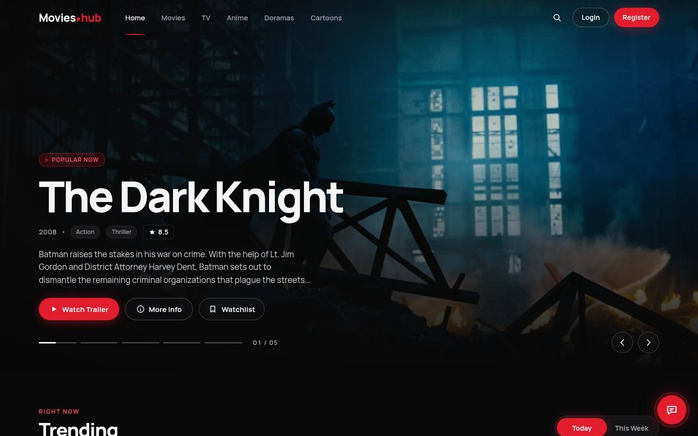

---

## Features

**Browse and discover**
- **Home page:**
  - hero carousel with trailers;
  - Trending rows (Today / This Week);
  - Movie of the Week, Coming Soon, Pick by Mood and Topic of the Day;
  - a TV and anime showcase.
- **Catalogs:**
  - Popular, Top Rated, Now Playing, Upcoming, Movies, TV, Anime, Doramas and Cartoons;
  - filters by genre, year, rating and country;
  - sorting (popularity, rating, newest, title) and pagination.
- **Detail page** for movies and TV shows: cast, trailer and stills, seasons and episodes, collections, similar titles and recommendations.
- **Search** with live suggestions in the header. Results come from TMDB and are merged with local data.
- **Popular actors** and what they are known for.

**Personal features**
- **Watchlist:**
  - one-click add and remove, without reloading the page;
  - watched / to-watch state;
  - filters by genre, year, country, rating and title.
- **Ratings and comments:** comments get likes and dislikes, and authors can delete their own comments.
- **Cinema Assistant:** an AI chat that recommends movies and shows based on your watchlist. It uses Groq `openai/gpt-oss-120b` and runs in the background through Celery.
- **Profile:** avatar upload, name and email settings, and connected accounts.

**Accounts and security**
- Register and log in with email and password, or with **Google** (django-allauth).
- Email verification and password reset by email. Accounts that use only Google can set a password this way.
- One account per email (case-insensitive). A Google account is linked to an existing account only if that account's email is verified.
- **Brute-force protection** (django-axes): 5 wrong passwords from the same IP lock that email for 15 minutes.
- Rate limits on sign-up, password reset, comments, votes and AI requests.
- A security event log (logins, lockouts, password and email changes). It never contains passwords or tokens.

---

## Screenshots

| Catalog (Anime) | Search |
|---|---|
| 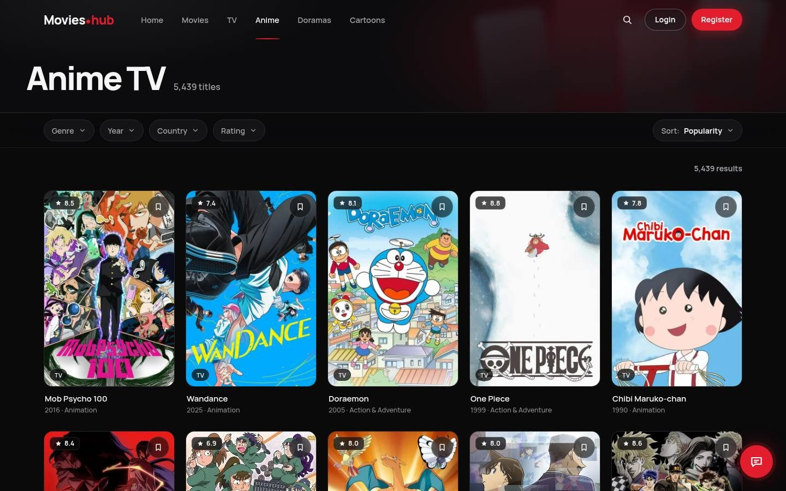 | 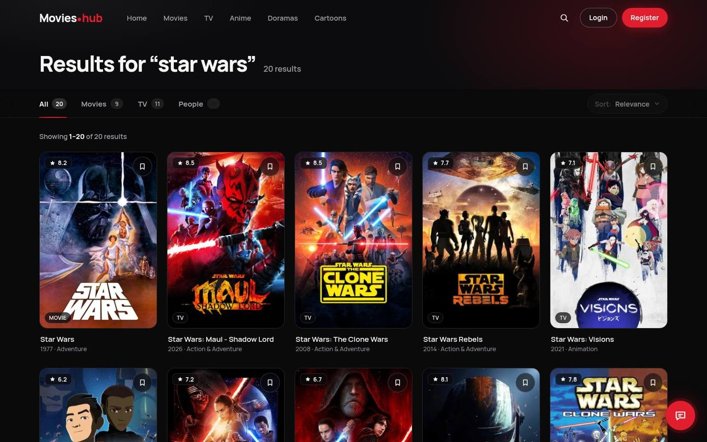 |

| Movie detail | TV show detail |
|---|---|
| 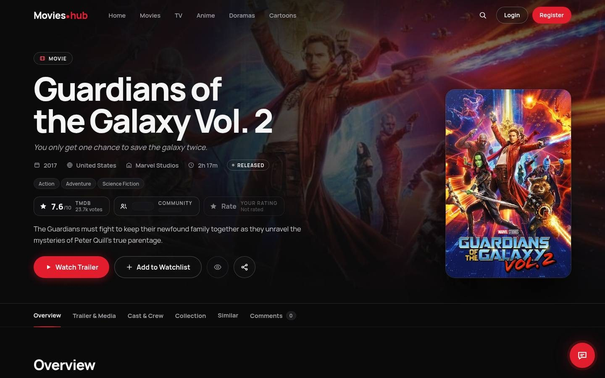 | 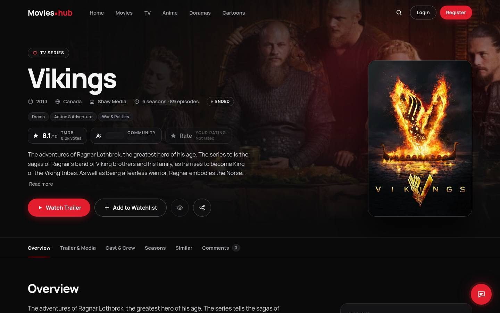 |

| Watchlist | Cinema Assistant (AI) |
|---|---|
| 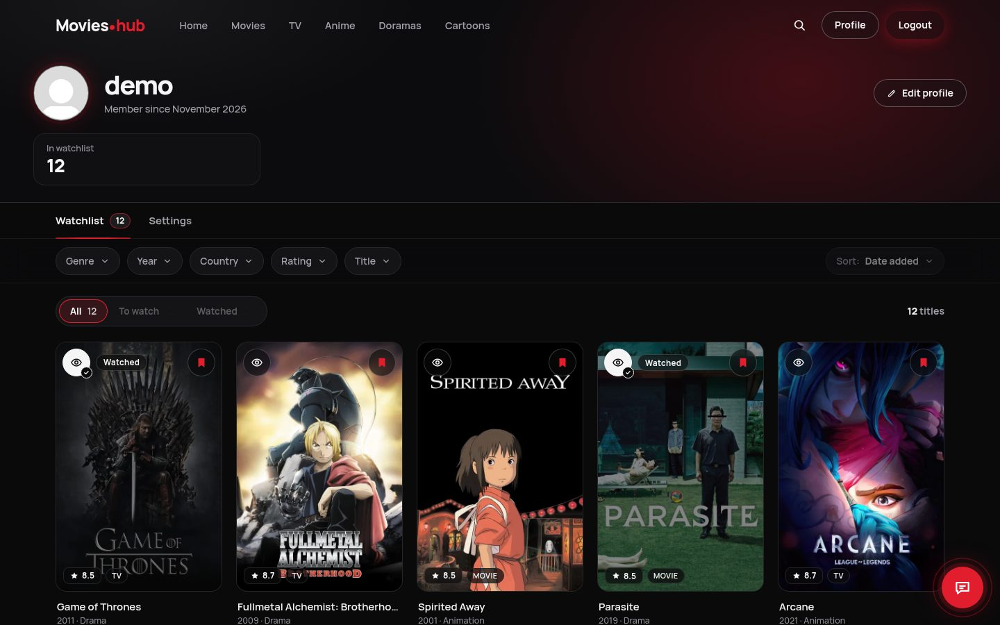 | 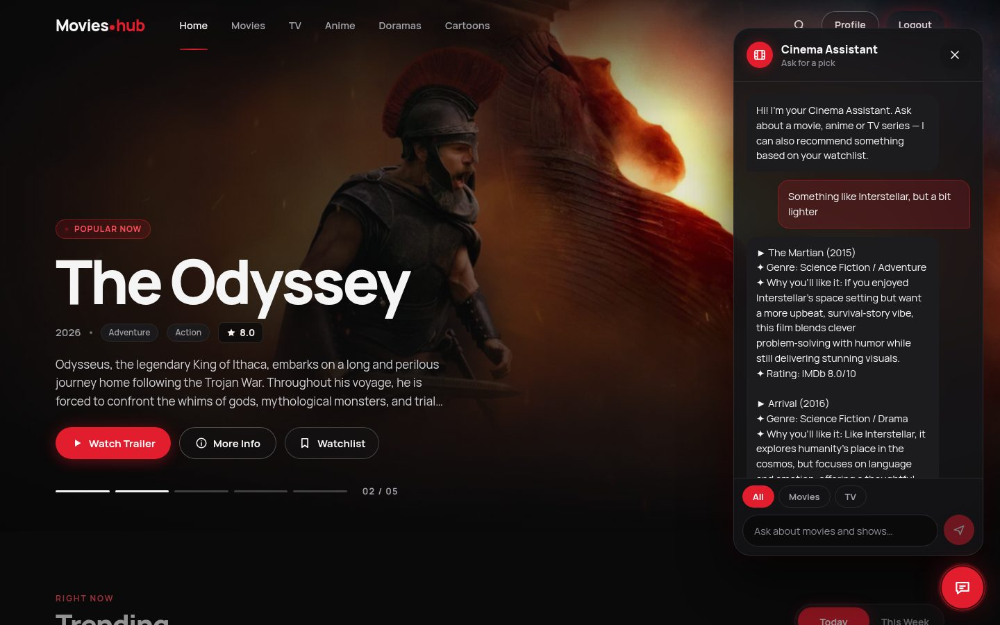 |

| Profile settings | Popular actors |
|---|---|
| 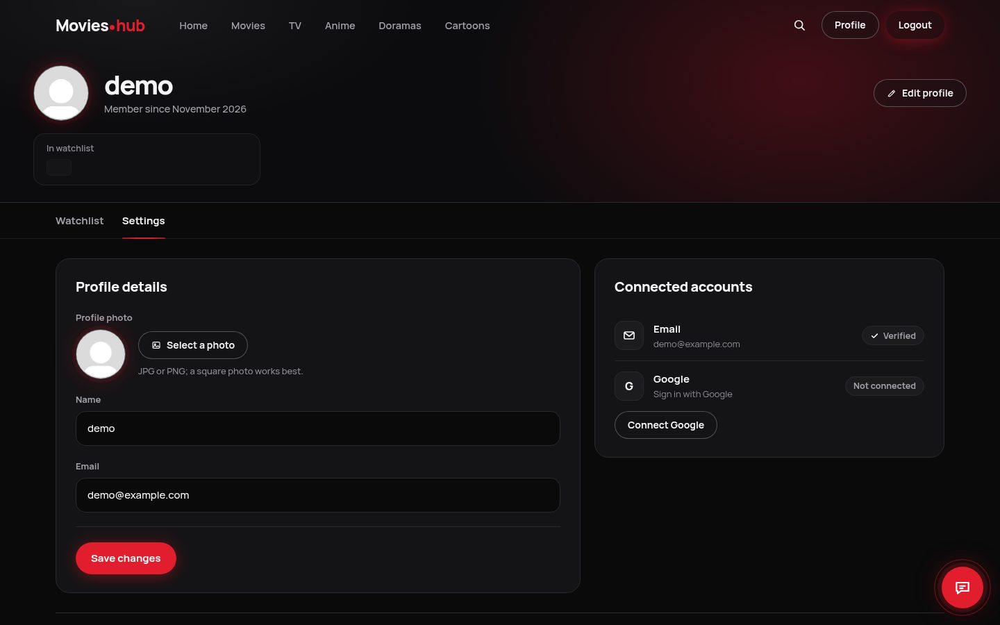 | 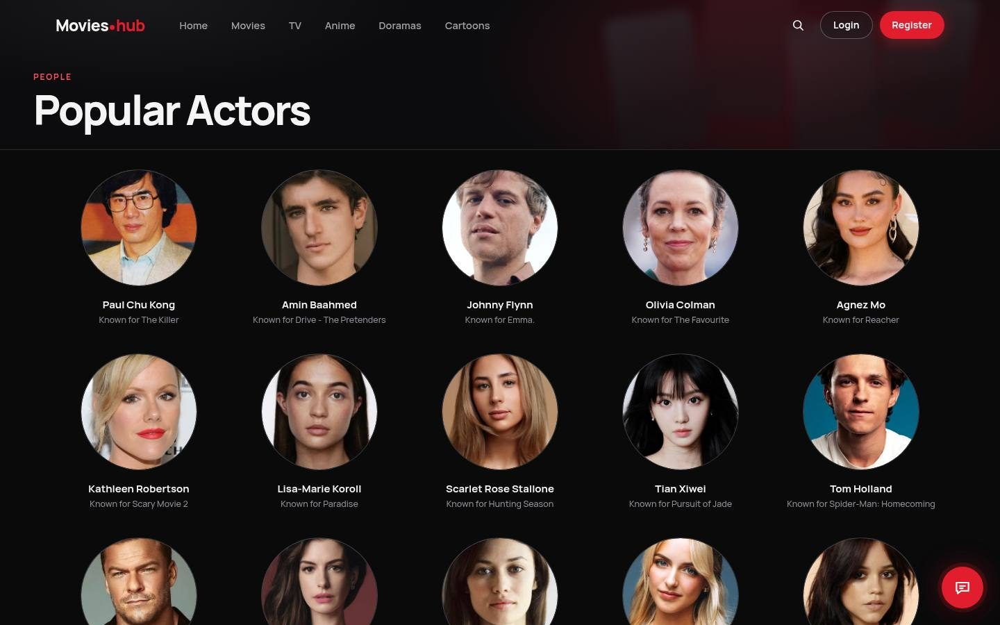 |

| Login | Register |
|---|---|
| 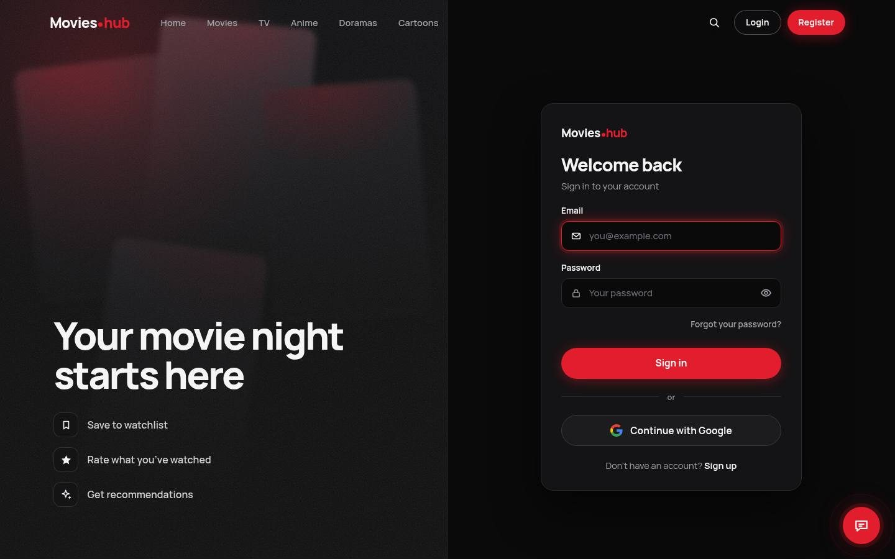 | 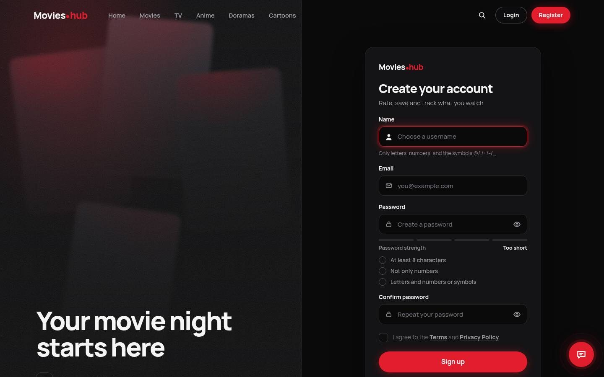 |

---

## Tech stack

| Area | Technology |
|---|---|
| Backend | Python 3.12, Django 5.2 LTS |
| REST API | Django REST Framework, JWT (djangorestframework-simplejwt) |
| Auth | django-allauth (Google OAuth, email verification), django-axes (lockout) |
| Frontend | Django templates, plain CSS and JavaScript, HTMX, Alpine.js (no build step) |
| Database | PostgreSQL (Neon in production, Postgres 16 in Docker locally) |
| Cache / queue | Redis: TMDB response cache, sessions and rate limits; Celery broker |
| Background jobs | Celery (AI recommendations) |
| External APIs | TMDB, Groq (LLM) |
| Static files | WhiteNoise |
| Tests / lint | pytest, pytest-django, pytest-mock (500+ tests), ruff, pre-commit |
| Deploy | Docker, Render |

---

## How it works

- **TMDB is the source of truth** for browsing and search. `movies/tmdb_service.py` wraps the TMDB API:
  - the detail page needs one request (`append_to_response`);
  - the Home page fetches about 25 rows in parallel.
- **Local `Movies` rows** exist only to attach watchlist entries, ratings and comments to a TMDB title (linked by `tmdb_id`).
- **Redis cache** (`movies/redis_services.py`):

  | What is cached | Kept for |
  |---|---|
  | TMDB lists | 12 h |
  | Genres | 36 h |
  | Detail, season and collection pages | 24 h |
  | Search results | 7 days |

  - Failed TMDB calls are never cached.
  - If Redis is down, pages still load straight from TMDB.
  - Per-user data (watchlist state) is added after the cache, so it is never cached.
- **AI assistant:**
  1. The chat sends a request.
  2. A Celery task calls Groq with your watchlist as context.
  3. The page polls `/movies/ai/status/<task_id>/` until the answer is ready.

---

## REST API

**Base URL:** `/api/`. Authenticated endpoints expect `Authorization: Bearer <access token>`. Access tokens live 60 minutes; refresh tokens live 7 days.

### Authentication

| Method | Endpoint | Description |
|---|---|---|
| POST | `/api/token/` | Get an access + refresh token pair (`username`, `password`) |
| POST | `/api/token/refresh/` | Get a new access token (`refresh`) |

### Movies and genres (public)

| Method | Endpoint | Description |
|---|---|---|
| GET | `/api/movie/` | Movies stored locally (paginated, filter: `?genre=Action`) |
| GET | `/api/movie/{id}/` | One movie |
| GET | `/api/genre/` | Genres |
| GET | `/api/rating/` | Ratings |

### Watchlist and profile (JWT)

| Method | Endpoint | Description |
|---|---|---|
| GET | `/api/watchlist/` | My watchlist |
| POST | `/api/watchlist/` | Add a movie: `{"movie_id": 12, "watched": false}` |
| GET / PUT / PATCH / DELETE | `/api/watchlist/{id}/` | Get, update (`watched`) or remove an entry |
| GET / PUT / PATCH | `/api/profile/` | My profile (username, email, avatar) |
| GET | `/api/recommendations/?message=...&type=all\|movie\|tv` | AI recommendations based on my watchlist (10/hour) |

### Comments

| Method | Endpoint | Auth | Description |
|---|---|---|---|
| GET | `/api/movie/{movie_id}/comments/` | ❌ | Comments on a movie (with likes / dislikes) |
| POST | `/api/movie/{movie_id}/comments/` | ✅ | Add a comment (10/hour) |
| GET | `/api/comments/{id}/` | ❌ | One comment |
| DELETE | `/api/comments/{id}/` | ✅ | Delete your own comment |
| POST | `/api/comments/{id}/vote/` | ✅ | `{"value": 1}` or `{"value": -1}`. The same value again removes the vote |

### Example

```bash
# Get tokens
curl -X POST http://localhost:8001/api/token/ \
  -H "Content-Type: application/json" \
  -d '{"username": "your_username", "password": "your_password"}'

# Authenticated request
curl http://localhost:8001/api/watchlist/ \
  -H "Authorization: Bearer <access_token>"
```

---

## Running locally (Docker Compose)

Docker Compose starts four services:
- `web`: the Django dev server on **http://localhost:8001**;
- `worker`: Celery;
- `db`: PostgreSQL 16;
- `redis`: Redis 7.

```bash
git clone https://github.com/KolyaHulchuk/film_project_django.git
cd film_project_django

cp .env.example .env
# Edit .env: SECRET_KEY, TMDB_API_KEY, GROQ_API_KEY and the POSTGRES_* values (see below)

docker compose up -d --build
docker compose exec web python manage.py migrate
docker compose exec web python manage.py createsuperuser   # optional
```

> Inside Docker Compose, `web` and `worker` build their own `DATABASE_URL` that points at the local `db` service, so local development never touches the production database. Run `manage.py` commands **inside the container**: on the host they would use `DATABASE_URL` from `.env`.

### Environment variables (`.env`)

| Variable | Required | Description |
|---|---|---|
| `SECRET_KEY` | ✅ | Django secret key |
| `DEBUG` | | `True` enables debug mode (default: off) |
| `ALLOWED_HOSTS`, `CSRF_TRUSTED_ORIGINS` | ✅ | Comma-separated, e.g. `localhost,127.0.0.1` and `http://localhost:8001` |
| `POSTGRES_DB`, `POSTGRES_USER`, `POSTGRES_PASSWORD` | ✅ (Docker) | Credentials for the local `db` service |
| `DATABASE_URL` | ✅ (outside Docker) | Postgres URL used in production / on the host |
| `TMDB_API_KEY` | ✅ | TMDB API key |
| `GROQ_API_KEY` | | Groq key for the AI assistant |
| `REDIS_URL` | | Default `redis://localhost:6379/0`. Docker Compose sets it automatically |
| `EMAIL_USER`, `EMAIL_PASS` | | Gmail SMTP for verification and password-reset emails |
| `DEFAULT_FROM_EMAIL` | | Sender, default `Movies.hub <EMAIL_USER>` |
| `GOOGLE_CLIENT_ID`, `GOOGLE_CLIENT_SECRET` | | Google login |
| `LOG_LEVEL` | | `INFO` (default) or `DEBUG` |
| `ADMINS` | | Emails that get a mail for every server error (500) when `DEBUG` is off |
| `CLIENT_IP_HEADER` | | Header with the real client IP behind a proxy (default `CF-Connecting-IP`) |

---

## Tests and lint

The tests mock TMDB and use an in-memory cache, so they need no API keys and do not touch Redis. Run them **inside the `web` container** so they use the local Postgres:

```bash
docker compose exec web pip install pytest pytest-django pytest-mock   # not in requirements.txt
docker compose exec web pytest                                          # full suite
docker compose exec web pytest movies/tests/test_comments.py -v         # one file

pip install ruff pre-commit
ruff check .            # lint
ruff format .           # format
pre-commit install      # optional git hook
```

---

## Deployment (Render)

Render builds the `Dockerfile` and runs it as a single container. `docker-compose.yml` is used only for local development.

- **Build:** the image installs `requirements.txt` and runs `collectstatic`. WhiteNoise serves the static files.
- **Start:** `migrate`, then a lightweight Celery worker, then the Django server on port 8000.
- **External services:** Neon PostgreSQL (`DATABASE_URL`) and hosted Redis (`REDIS_URL`; `rediss://` turns on TLS).
- Behind Render's HTTPS proxy, the app trusts `X-Forwarded-Proto` so Google OAuth callbacks use `https`.

---

## Project structure

```
film_project_django/
├── config/              # settings, root URLs, Celery app, WSGI/ASGI
├── movies/              # core: TMDB client, catalog/home/detail/search views, comments, AI
│   ├── tmdb_service.py  #   TMDB API client
│   ├── redis_services.py#   Redis cache helpers
│   ├── services.py      #   Groq AI recommendations
│   ├── tasks.py         #   Celery task for the AI assistant
│   ├── comments.py      #   shared comment / vote logic
│   ├── templates/       #   pages, partials and components
│   ├── static/movies/   #   CSS and JS
│   └── tests/
├── users/               # auth, profile, watchlist, Google linking, security
│   ├── adapters.py      #   allauth adapters (safe Google linking)
│   ├── backends.py      #   email login backend
│   ├── lockout.py       #   django-axes hooks
│   ├── security_log.py  #   security event log
│   ├── throttling.py    #   rate limits
│   └── tests/
├── api/                 # DRF serializers, views and URLs
├── screenshots/         # images used in this README
├── Dockerfile           # production image (Render)
├── docker-compose.yml   # local dev: web, worker, db, redis
└── requirements.txt
```

---

Data provided by [TMDB](https://www.themoviedb.org/). This product uses the TMDB API but is not endorsed or certified by TMDB.
